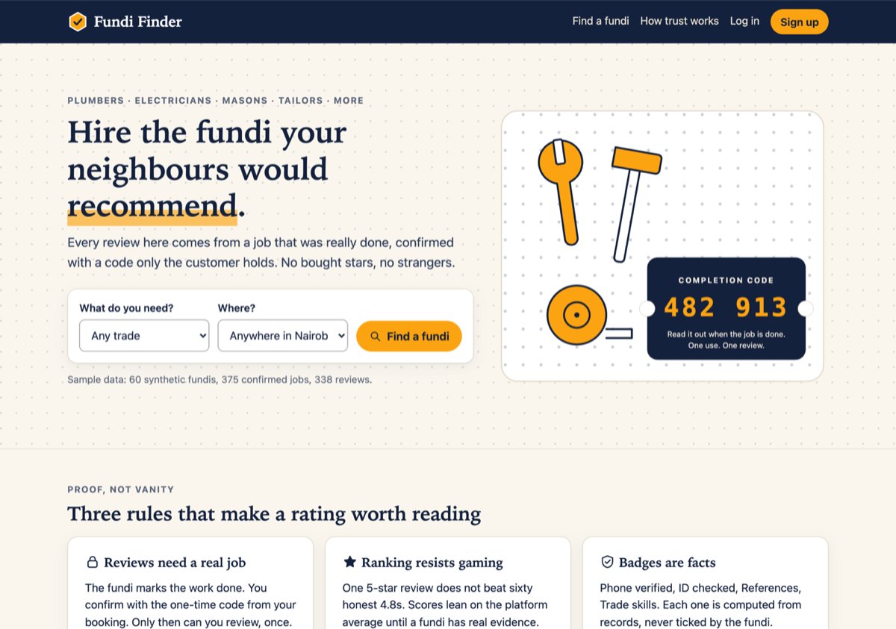
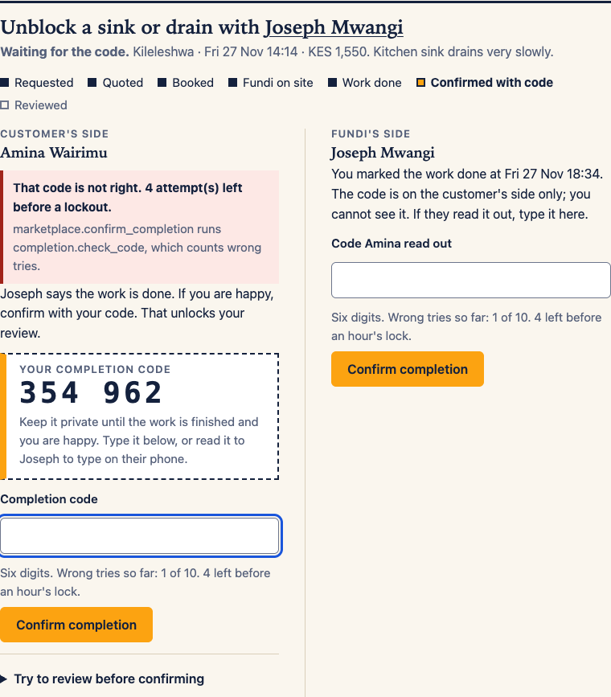
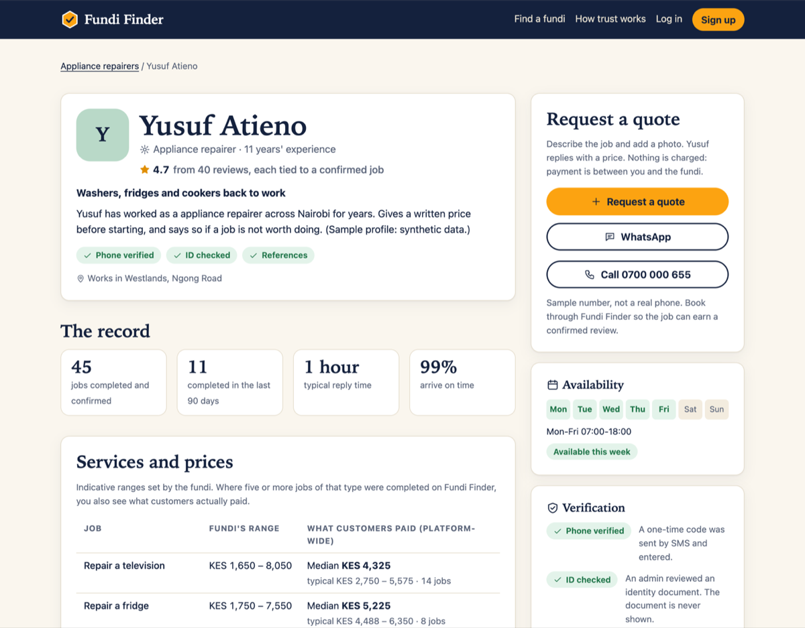
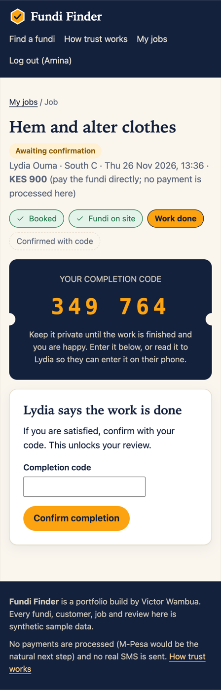
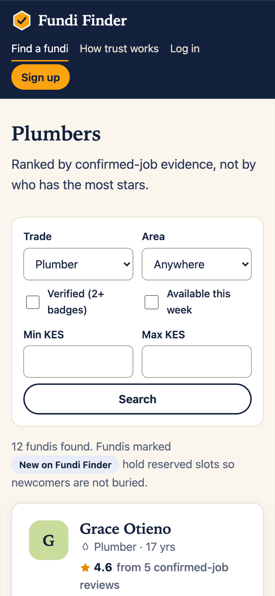
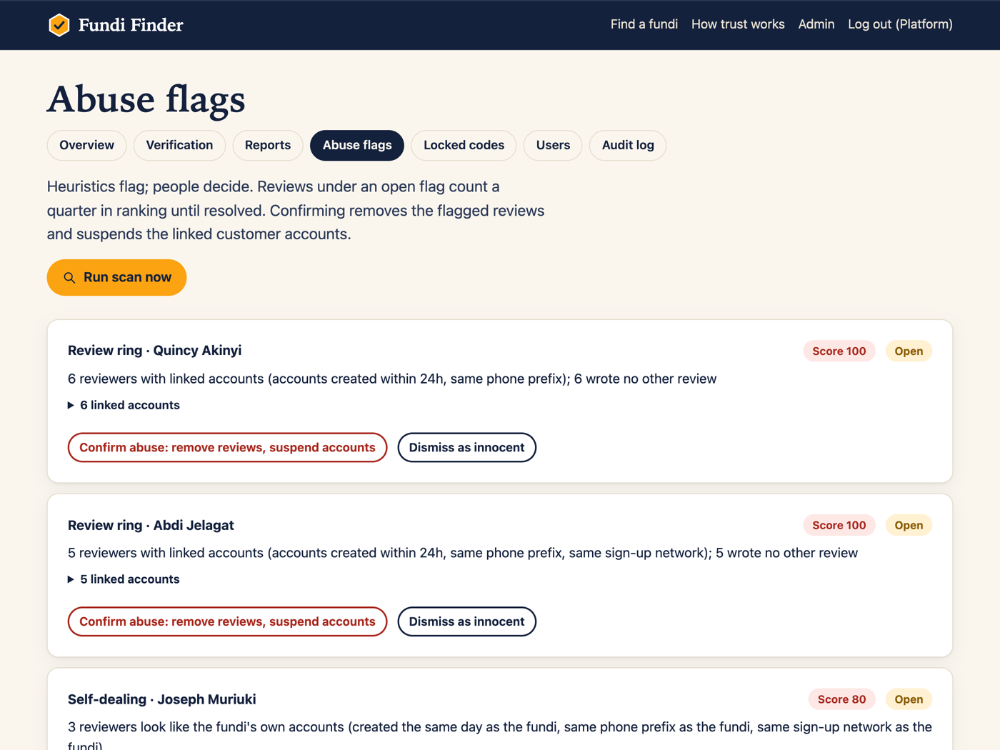

# Fundi Finder

**Find and book local artisans on a track record you can check: reviews only from jobs that were really done.**

[](https://github.com/Victor-Wambua/fundi-finder/actions/workflows/ci.yml)


**[Try the live demo](https://victor-wambua.github.io/fundi-finder/)**: the real Python code, running in your browser on invented data.

> **Status:** portfolio build. Runs locally with synthetic sample data. No payments, no real SMS, not field-tested.



*Fundi* is Swahili for a skilled artisan: plumber, electrician, mason, tailor.

## Live demo

[victor-wambua.github.io/fundi-finder](https://victor-wambua.github.io/fundi-finder/) runs this repository's own domain code (`models`, `queries`, `ranking`, `marketplace`, `lifecycle`, `completion`, `reviews`) in the browser with Pyodide, SQLAlchemy and an in-memory SQLite database, all served from the repo's files. Nothing is sent anywhere, and it works offline after the first load.
Real: search and ranking, quotes, booking, the job state machine, completion codes (wrong, locked, disabled, reused) and the review gate. Simulated: the people, jobs and reviews (invented), the web layer (Flask routes, sessions, login), the clock (you can skip it), and the actor for each button, since one visitor plays both customer and fundi.
The code secret is visible in the browser, so the demo shows how the code works, not how it stays secret. Not shown: uploads, ID review, SMS, reports, abuse queue. Source in [`demo/`](demo/); `make demo` builds and serves it on port 8950, `make demo-test` runs the Playwright smoke test. CI builds the demo and runs that test on every push.



## The problem

Most people in Nairobi find a fundi by asking a neighbour. That breaks down for new tenants,
and it hides good fundis who have no way to show a stranger eighty honest jobs. Customers get
no-shows and quotes that differ three times over for the same tap. Star ratings online are easy
to buy, and one 5-star review ranks a stranger above a fundi with a long record.

Fundi Finder makes the record hard to fake, then shows it plainly. The design reasoning is in
[docs/CASE-STUDY.md](docs/CASE-STUDY.md).

## What it does

**Trust mechanics (the product)**

- **Reviews only from confirmed jobs.** The customer gets a six-digit completion code at
  booking. The fundi marks the work done; the customer confirms with the code (or reads it out
  and the fundi types it). Single use, wrong-guess lockout, one review per job, fundi can reply,
  reviews can be reported, edits close after 14 days.
- **Ranking that resists gaming.** Bayesian mean pulled to the platform average, recency
  weighting, reply-rate, on-time rate, confirmed-job count and badges. Newcomers hold every
  fourth result slot instead of getting a score bonus. See [docs/RANKING.md](docs/RANKING.md).
- **Badges computed from facts:** Phone verified (SMS one-time code), ID checked (admin reviews a
  private upload), References (two customers on different numbers confirm), Trade skills (three
  portfolio photos).
- **Anti-abuse:** rate limits, duplicate-account and review-ring heuristics, report, takedown and
  appeal (a different admin decides), full audit log.
- **Price transparency:** the median agreed price per job type, shown once five jobs have
  completed.

**Customer:** search by trade and area; filters for verified, available this week and price
range; honest profile with rating breakdown and a Wilson lower bound; request a quote with a
photo; accept; booking with code; WhatsApp and call buttons.

**Fundi:** profile and price ranges in KES, weekly availability with day exceptions,
portfolio, requests inbox, quote composer, jobs, reply to reviews, earnings summary.

**Admin:** ID verification queue, reports and appeals, abuse flags, user suspension, locked
codes, audit log, platform stats.

| | |
|---|---|
|  |  |
|  |  |

Also: [dark mode](docs/screenshots/06-profile-dark.png) and the
[fundi workshop](docs/screenshots/07-fundi-workshop.png).

## Quick start

Needs [uv](https://docs.astral.sh/uv/) and Python 3.12. No Docker, no Node, no external services.

```bash
git clone https://github.com/Victor-Wambua/fundi-finder.git
cd fundi-finder
uv sync
uv run flask --app fundifinder seed      # 60 synthetic fundis, ~420 jobs, ~340 reviews
uv run flask --app fundifinder run       # http://127.0.0.1:5000
```

If port 5000 is taken (macOS AirPlay Receiver uses it), add `--port 5001`.

Demo logins, all synthetic, password `demo-password-123`:

| Role | Email | Try this |
|---|---|---|
| Customer | `customer@fundifinder.test` | Open the job awaiting confirmation, enter the code, leave a review |
| Fundi | `fundi@fundifinder.test` | Quote an open request, start and finish a job |
| Admin | `admin@fundifinder.test` / `admin2@fundifinder.test` | Review ID documents, resolve reports, confirm the abuse flags. Appeals need the *other* admin |

Verification SMS codes are written to the console and to a dev page at `/dev/outbox`. To start
over: `uv run flask --app fundifinder seed --reset`. `make seed`, `make run`, `make test` and
`make check` are shortcuts.

## How it works

```mermaid
flowchart LR
  C[Customer] -->|request + photo| R[QuoteRequest]
  R -->|fundi quotes| Q[Quote]
  Q -->|customer accepts| J[Job: booked + code salt]
  J -->|fundi starts| P[in progress]
  P -->|fundi marks done| A[awaiting confirmation]
  A -->|code entered, single use| D[completed]
  D -->|only now| V[Review, one per job]
  V --> S[Ranking + abuse scan]
```



- **Flask 3** application factory with five blueprints (`public`, `auth`, `customer`, `fundi`,
  `admin`). **SQLAlchemy 2** on SQLite, one session per request. Jinja templates, HTMX vendored
  locally (no CDN), hand-written CSS with design tokens and dark mode.
- **Domain logic is plain modules with no Flask imports:** `ranking`, `lifecycle` (state
  machine), `completion` (codes), `badges`, `abuse`, `pricing`, `availability`, `uploads`.
  Blueprints stay thin.
- **Security:** CSRF on every POST, signed cookie sessions with rotation on login, scrypt
  passwords, strict CSP with no inline script or style, rate limiting, constant-time code
  comparison, uploads checked by magic bytes and re-encoded (EXIF stripped), ID documents in a
  private directory behind one admin-only endpoint that logs every view.
- **Money** is integer KES.

## Testing

```bash
make test        # uv run pytest
make check       # ruff + format check + mypy + pytest
```

**325 tests, all passing, offline, about 30 seconds. Line coverage 88%.** Ruff and mypy
(strict) are clean, and CI runs lint, type check and tests on every push.

| Area | Tests |
|---|---|
| Ranking maths, worked examples, Hypothesis properties (monotonicity, 1×5★ vs 60×4.8★) | 28 |
| Job state machine, including every illegal transition from terminal states | 31 |
| Completion code: single use, lockout, invalidation, re-issue | 15 |
| Review gate, edits, replies, reports, takedown, appeals | 33 |
| Marketplace rules, search filters, response/punctuality inputs, OTP, ID review, references | 30 |
| Badge derivation | 8 |
| Uploads: type, size, magic bytes, EXIF, traversal | 29 |
| Abuse heuristics, including detection of the planted rings in the seed | 22 |
| Pricing, availability, phones, forms, rate limiter, redirects | 36 |
| HTTP: CSRF, auth, permissions, private ID documents, headers, upload flows | 62 |
| End to end: request, quote, booking, complete, review (both confirm paths) | 5 |
| Seed data invariants | 14 |

## Project layout

```
src/fundifinder/
  __init__.py        app factory
  models.py          SQLAlchemy models
  ranking.py         score formula, Wilson bound, reserved-slot ordering
  lifecycle.py       job state machine
  completion.py      one-time completion codes
  badges.py          verification badges from facts
  abuse.py           ring and self-dealing heuristics (pure)
  abuse_scan.py      runs them on the database, records flags
  marketplace.py     request -> quote -> job rules
  reviews.py, moderation.py, verification.py, queries.py
  uploads.py, sms.py, security.py, seed.py, cli.py
  blueprints/        public, auth, customer, fundi, admin
  templates/, static/
tests/               pytest suite
docs/                CASE-STUDY.md, RANKING.md, screenshots/
demo/                static browser demo: engine (Python), page, vendored Pyodide, smoke test
```

## Configuration

Environment variables, all optional in development (see `.env.example`):

| Variable | Default | Meaning |
|---|---|---|
| `FUNDI_SECRET_KEY` | dev-only value | Signs sessions and derives completion codes. **Set it for anything non-local.** `FUNDI_ENV=production` refuses the default |
| `FUNDI_DATABASE_URL` | `sqlite:///instance/fundifinder.db` | SQLAlchemy URL |
| `FUNDI_INSTANCE_DIR` | `./instance` | Database and uploads |
| `FUNDI_SMS_PROVIDER` | `console` | Only `console` exists. Add an adapter with `send(to, body)` |
| `FUNDI_DEV_OUTBOX` | `1` | Serves `/dev/outbox`. Turn off outside local use |
| `FUNDI_RATELIMIT_ENABLED` | `1` | In-memory limits on log-in, sign-up, codes, requests |
| `FUNDI_COOKIE_SECURE` | `0` | Set to `1` behind HTTPS |

## Status and roadmap

Honest status: a portfolio build that runs locally. All people, phone numbers, jobs, reviews
and images are synthetic and generated. Nothing has been tested with real fundis or customers.

Known limitations:

- **No payments.** Prices are quotes; money moves outside the app. M-Pesa is the natural next
  step.
- **SMS is a console provider.** No message leaves the machine.
- **The code can be defeated by collusion.** It proves a customer and fundi met in the app, not
  that the job was honest. The ring heuristics catch throwaway accounts only.
- **Ranking weights are judgement,** not fitted to data. See the failure modes in `docs/RANKING.md`.
- Rate limiting is per process. Moderation is one queue and does not scale.
- Portfolio photos are not checked to be the fundi's own work.

Next steps: M-Pesa STK push and payout reconciliation; a real SMS adapter; a shared rate-limit
store; Swahili translations; an installable PWA shell for offline job lists.

---

Built by Victor Wambua · [portfolio](https://victor-wambua.github.io/victor-portfolio/) · [case studies](https://github.com/Victor-Wambua/case-studies)

Licensed under the [MIT License](LICENSE).
