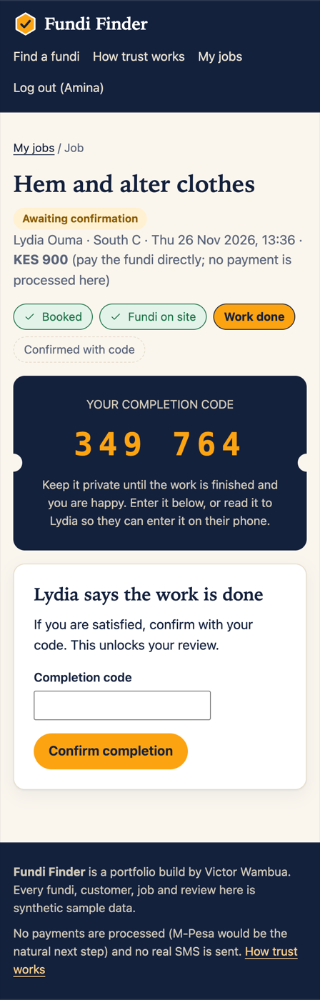
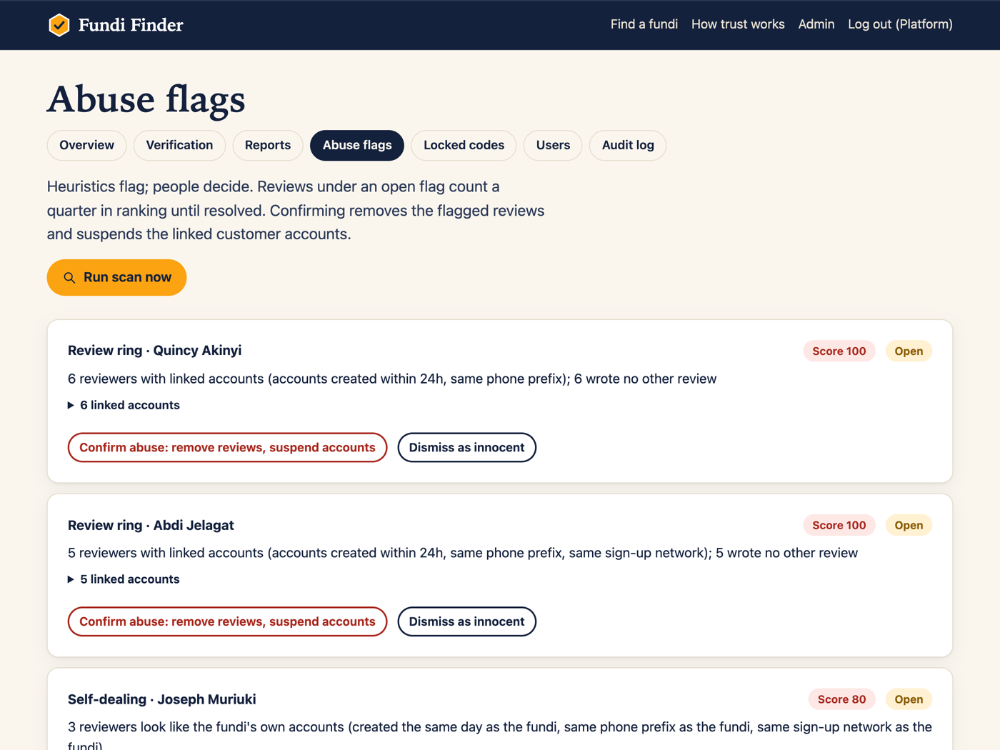

# Case study: Fundi Finder

## The problem

In Nairobi most people find a plumber, electrician or mason by asking a neighbour. It works
because a neighbour knows whether the fundi turned up, charged what he said, and did the job
properly. It fails everywhere else. A new tenant has no neighbours. A good fundi who is new to
an estate has no way to show eighty honest jobs to a stranger. Customers get no-shows and
quotes that differ by three times for the same tap. Online star ratings do not fix this,
because they are easy to buy, and one 5-star review ranks a stranger above a fundi with a long
record.

Fundi Finder is my attempt to treat that as a design problem: make the record itself hard to
fake, then show it plainly.

## Goals and non-goals

Goals: reviews that cannot exist without a real job; ranking that does not reward gaming;
badges that are facts, not claims; a usable booking flow on a phone.

Non-goals: payments (M-Pesa is the natural next step and is not built), real SMS, a native
app, moderation at scale. Everything runs locally on synthetic data.

## What I built

A Flask 3 application (SQLAlchemy 2, SQLite, Jinja and a vendored copy of HTMX) with three
roles. Customers search by trade and area, read a fundi's record, request a quote with a
photo, accept it, and confirm the finished job. Fundis manage profile, prices, a weekly
availability pattern with exceptions, an inbox, quotes and jobs. Admins work a verification
queue, a reports and appeals queue, abuse flags and an audit log. A seed script creates 60
fundis, about 420 jobs and 340 reviews, including three planted review rings.

## Design decisions and trade-offs

**1. Reviews are gated by a completion code, not by account age or purchase.** Open reviews
fail because nothing ties a review to an event. A code shown only to the customer at booking
ties it to one: the fundi marks the work done, then the customer confirms with the code. The
alternative I weighed was a "verified purchase" flag, which needs payments I did not build.
The cost is friction, and a gap: customers without data cannot type the code. So the fundi can
enter it when the customer reads it out. That keeps the property (only someone holding the
code can confirm) while fitting how people actually work. The code is HMAC-derived from a
per-job salt, single use, and wrong guesses lock entry for an hour and disable the code after
ten.

**2. A Bayesian mean, with no bonus for newcomers.** A raw average ranks a fundi with one
5-star review first. Pulling every fundi toward the platform mean until they have evidence
fixes that. My first instinct was a score boost for new fundis, so they would not be buried. I
dropped it: a boost breaks monotonicity and is the first thing an attacker would optimise. New
fundis instead hold every fourth result slot, rotated daily and labelled. The formula and
worked examples are in [RANKING.md](RANKING.md).

**3. Abuse heuristics flag; they never act.** A cluster of three or more reviewers of one
fundi is flagged when their accounts are linked by at least two of: created within 24 hours,
same phone prefix, same sign-up network, and at least half of them wrote no other review. One signal
is not enough: families share Wi-Fi and SIMs are sold in blocks. A first version flagged an
honest fundi with 40 reviews through coincidence, which is why the "mostly single-purpose
accounts" condition exists. Flagged reviews count a quarter in ranking until an admin decides;
confirming removes them and suspends the accounts. A cheaper evasion (aged accounts that also
review other fundis) passes, and I say so.

**4. ID documents are stored privately and re-encoded.** Uploads are checked for size, magic
bytes, extension agreement, pixel budget and decodability. Images are re-encoded, which drops
EXIF and GPS data from customers' photos. ID documents go to a directory that has no public
route. The only way to read one is an admin-only endpoint that sets `no-store` and writes an
audit entry each time. The demo only ever contains generated placeholder images. The
alternative, a third-party eKYC service, was out of scope.

**5. Takedowns can be appealed by a different admin.** Reports remove content; the author can
appeal once within 14 days, and the same admin cannot decide their own appeal. It costs a
second admin account in the demo and is the minimum I would accept for a system that removes
people's words.

**6. Server-rendered pages, HTMX only where it helps.** Search filters, the phone-code step and
"show more" use HTMX; everything else is plain forms. No CDN, a strict CSP with no inline
script or style, and 12 results per page keep pages small. The cost is some template
duplication; the benefit is that every flow works without JavaScript.

## How it is kept correct and safe

313 tests, all offline. The ranking maths has worked examples and Hypothesis properties
(an extra 5-star never lowers the score; one 5-star never beats sixty 4.8s). The job lifecycle
is a transition table with every illegal pair tested, and a test asserts that only `confirm`
can reach `completed`. The review gate is tested at three layers: domain function, HTTP, and a
full request, quote, booking, completion and review flow through the test client. Permission
tests cover the awkward cases: a fundi cannot review their own job, a customer cannot see
another's job, the fundi page never contains the code, and ID files are unreachable except by
admins. CSRF is checked on every POST.

Two bugs the tests caught are worth recording. A new quote did not supersede the previous one
because a cached relationship was stale, and the portfolio upload read its file stream twice
and stored empty files. Money is integer KES throughout. SQL is parameterised through the ORM.

## What I would do differently

Add M-Pesa first: price and payment would give the review gate a stronger anchor than a code.
Measure before weighting: the five ranking weights are judgement, not fitted. Replace the
in-memory rate limiter with a shared store before running more than one worker. Use a
real SMS provider behind the existing interface. Give moderators context about the whole
history of an account, not one review at a time.

## Status

Portfolio build. Runs locally with synthetic data: names, phone numbers, jobs, reviews and
images are generated. SMS is a console provider. No payments. Not field-tested with a single
real fundi or customer, so the ranking weights and abuse thresholds are untested against
real behaviour. Moderation at scale is not solved: one admin queue works at demo size.
